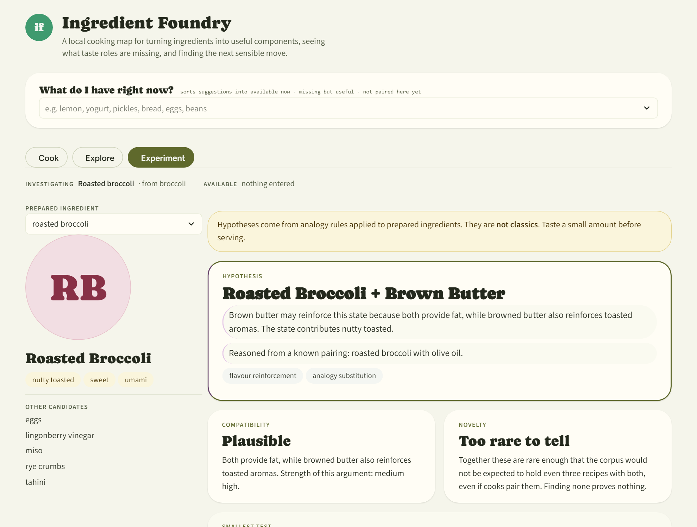
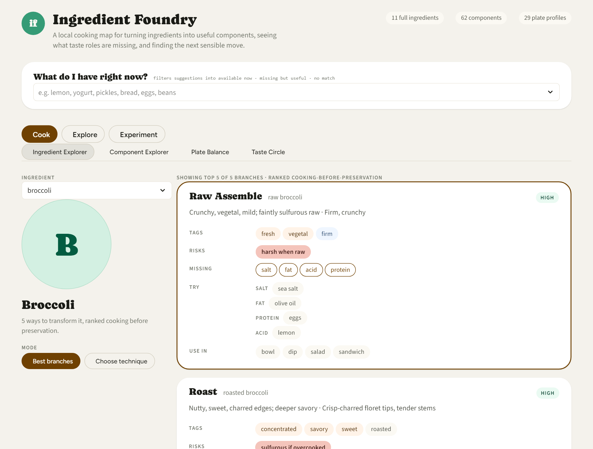
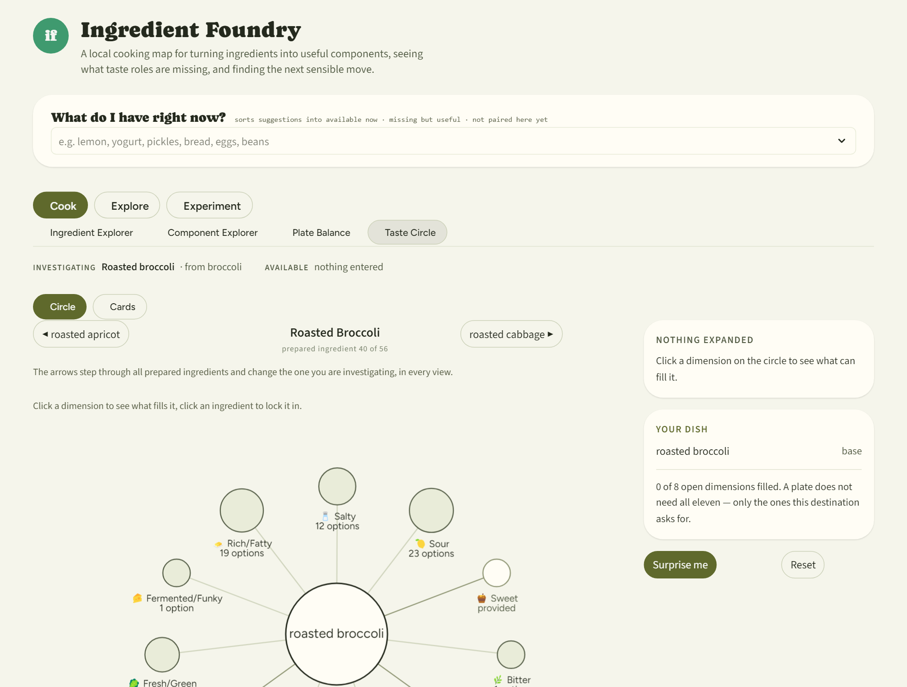
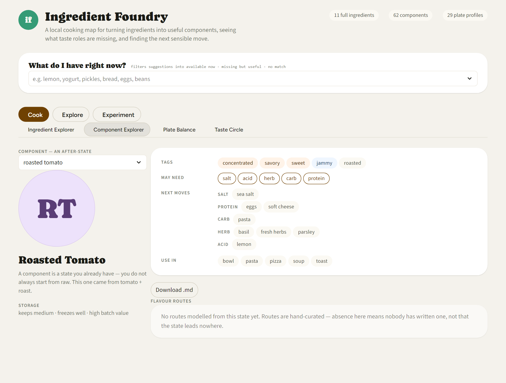
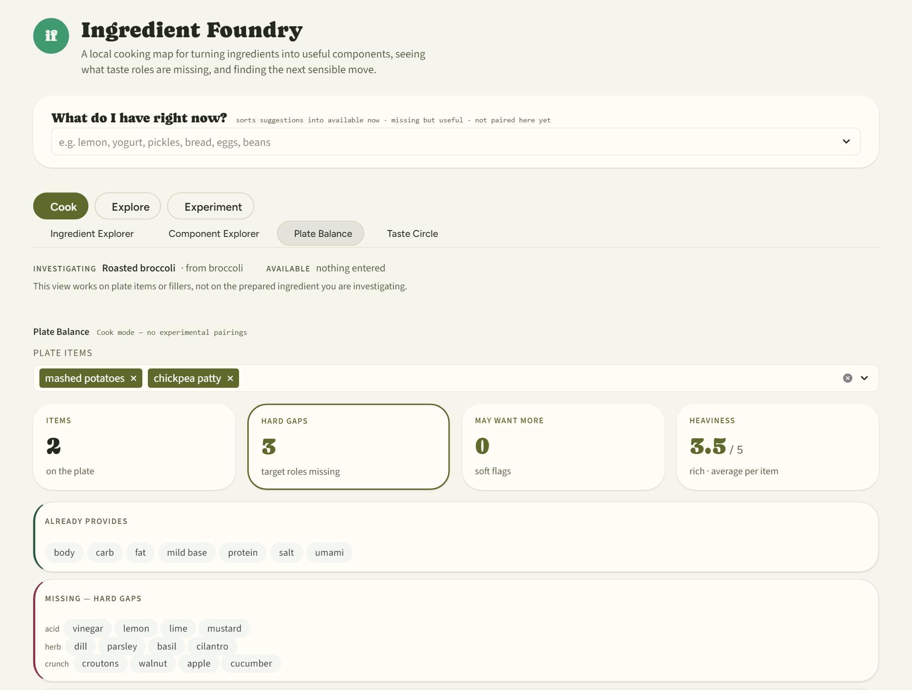
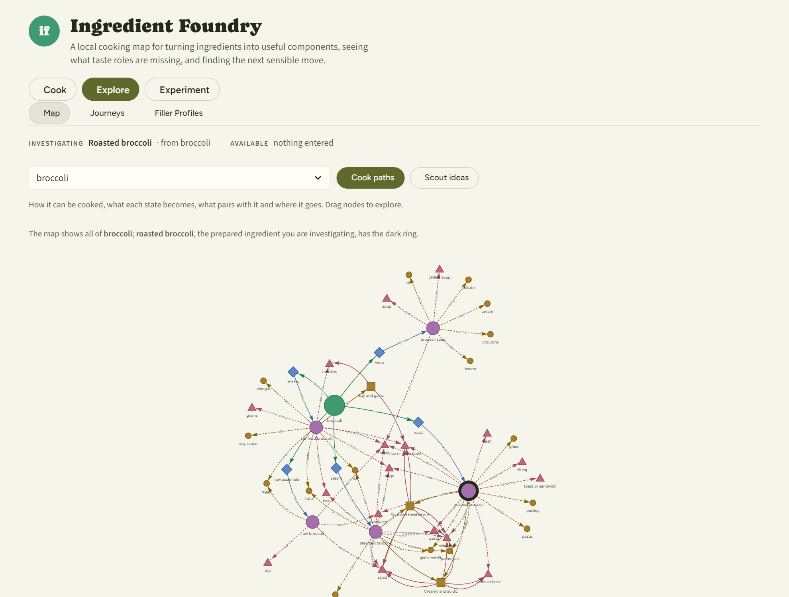
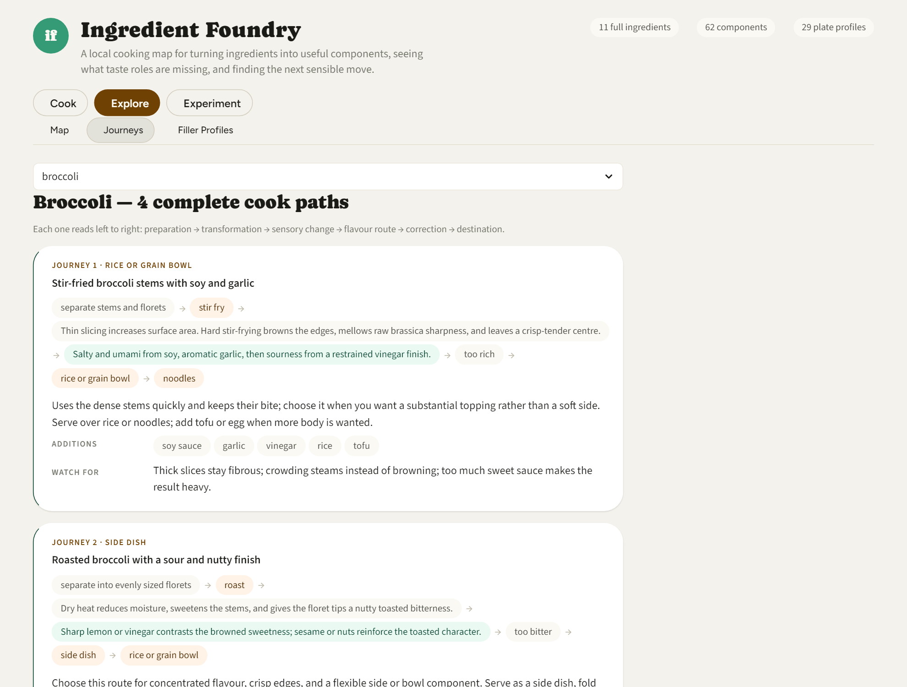

# food-prep — Ingredient Foundry

A local-first cooking map. It starts from what an ingredient **becomes**,
not from recipes: roasted broccoli is not raw broccoli, and the next good move
depends on which one you have.

It answers four questions:

- What can this ingredient turn into, and what changes when it does?
- I already have this cooked thing. What does it still need?
- What is missing from this plate?
- What uncommon pairing is worth tasting, and how would I test it safely?

Everything runs on your machine: curated YAML compiled into SQLite, a Python
query layer, a CLI and a Streamlit app. No cloud services, no language models.



## Two modes, kept apart on purpose

**Cook** uses established kitchen knowledge to give the next sensible move.
It covers transformation branches, what a state is missing, flavour routes,
plate balance and complete cook paths.

**Scout** proposes plausible but uncommon pairings. It never mixes them into
Cook answers. Each hypothesis carries three claims that are never merged into a
single score:

| Claim | What it says | Where it comes from |
| --- | --- | --- |
| **Compatibility** | why the pairing should work | an explicit analogy rule ("brown butter may replace olive oil on a toasted state because…") |
| **Novelty** | how common the pairing is | co-occurrence in 45,772 CulinaryDB recipes, with its evidence scope named |
| **Result** | whether it actually tastes good | only a recorded tasting can say this |

## First proof: one ingredient, two truths

The product design asks one pilot ingredient to carry the whole loop before
the catalogue grows. **Broccoli now meets every condition:**

| Condition | Broccoli |
| --- | --- |
| four complete Cook journeys | ✅ 4: stir-fried stems, roasted florets, steamed and dressed, roasted and crushed |
| at least three destination types | ✅ 7: side dish, grain bowl, noodles, salad, sauce or base, filling, toast |
| at least three reusable flavour routes | ✅ soy and garlic · sour and toasted nut · creamy and acidic |
| a Scout hypothesis from an explicit analogy | ✅ brown butter for olive oil on a toasted state |
| compatibility and novelty as separate evidence | ✅ two cards, never one score |
| a tasting protocol and an honestly recorded result | ✅ 2026-08-12: brown butter on roasted broccoli **works**, though garlic confit on the same state was better |

The broader tasting phase ends at five recorded tastings. **One is recorded so
far.**

## The app

```bash
pip install -e ".[gui]"
streamlit run app.py
```

Three sections, each with its own tabs:

- **Cook**
  - **Ingredient Explorer**: an ingredient's transformation branches, each with tags, risks, missing roles and what to add.
  - **Component Explorer**: start from a state you already have, such as roasted tomato, instead of a raw ingredient.
  - **Plate Balance**: what a plate already has, what it lacks, and what not to add more of.
  - **Taste Circle**: build a dish around a state by filling flavour dimensions. It has two views, *Circle* and *Cards*, which share one dish.
- **Explore**
  - **Map**: the ingredient as a graph, as *Cook paths* or *Scout ideas*.
  - **Journeys**: complete cook paths from preparation to destination.
  - **Filler Profiles**: what each addition does, repairs and should be kept away from.
- **Experiment**
  - **Scout**: one hypothesis at a time, with its claims and its smallest test.

**What do I have right now?** at the top sorts suggestions into *available
now*, *missing but useful* and *no match*. It is not a pantry tracker; it only
asks what is in the kitchen right now.

| | |
| --- | --- |
|  |  |
|  |  |
|  |  |

**Recording a tasting.** Under each Scout hypothesis, *Record a tasting* opens
a short form (verdict, what you did, ratio, temperature, what you tasted, and a
safety confirmation). Saving **appends** the trial to
`src/foodprep/data/tastings.yaml`, the file the app rebuilds from, and never
edits what is already there. Commit that file to keep the record. On a hosted
deployment, where the package folder is not durable, set
`FOODPREP_TASTINGS_PATH` to a file that is; the app then reads and writes there.

Screenshots are reproducible: `python scripts/capture_screenshots.py` (needs
Playwright with Chromium or a system Chrome). Re-run it after any UI change.

## The CLI

```bash
pip install -e ".[dev]"
foodprep build                                   # compile YAML into foodprep.sqlite

foodprep ask "i roasted broccoli now what"       # missing roles and what to add
foodprep journey broccoli                        # complete cook paths
foodprep plate "mashed potatoes and chickpea patty"
foodprep hypotheses roasted_broccoli_component   # Scout, with novelty and protocol
foodprep protocol roasted_broccoli_component brown_butter
foodprep record-tasting roasted_broccoli_component brown_butter --verdict works --preparation "tossed while warm" --ratio "1 floret : 1/4 tsp" --temperature warm --observations "nutty, not greasy" --safety-confirmed
                                                 # appends to tastings.yaml; --db-only to skip
foodprep demo                                    # five flows in about a minute
```

Every result can be exported as Markdown with `foodprep export`.

## How Scout stays honest

A rule is an analogy: *known pairing → substitute → why*. Matching rules on
flavour tags alone produced nonsense, such as a potato-soup rule telling cooks
to put "1 cup soup : 1 anchovy fillet" on roasted broccoli. Now:

- **Every state has a serving form** (cooked pieces, raw or salad, soup, mash,
  sauce, pickle and so on), derived from its technique.
- **Every state-owning ingredient has a family** (brassica, root or tuber,
  sweet fruit and so on).
- **Every rule declares where its wording holds**: forms, optionally narrowed
  by families, or an exact list of states. An unscoped rule fails the build.
- **Rules that travel use a `{state}` placeholder**, so the test reads
  "1 small piece of roasted broccoli", not a food it isn't.
- **A wording guard** rejects any hypothesis whose text names another
  ingredient or another serving form, and a test keeps that guard's catch
  empty. A mis-scoped rule therefore gets fixed in the data instead of
  silently disappearing.

**Novelty is measured, not guessed.** Each candidate is looked up in
CulinaryDB:

- by its own name, plural, or a short list of identical foods (caraway seeds
  → caraway);
- never by a broader family (brown butter is not butter);
- and, where CulinaryDB files a specific ingredient under a general one
  (balsamic → vinegar), by the recipe's original wording.

A zero only counts as evidence where the corpus could have shown the pairing
(at least three expected co-occurrences). Below that the card says *too rare to
tell*, and when the corpus does not contain an ingredient at all, the card
names it.

## Data

The YAML in `src/foodprep/data/` is the source of truth. The database is a
build artifact that is rebuilt from it every time.

| File | Holds |
| --- | --- |
| `tomato.yaml` | ingredients, techniques, transformations, state profiles, pairings, journeys (despite the name, all eleven ingredients) |
| `vocabularies.yaml` | the controlled language: flavours, textures, destinations, serving forms, ingredient families, confidence |
| `scout_rules.yaml` | analogy rules with their scope and tasting protocol |
| `flavour_routes.yaml` | reusable dressing combinations and the states they fit |
| `component_profiles.yaml`, `destination_profiles.yaml` | plate-balance profiles |
| `tastings.yaml` | **append-only** kitchen results; a disagreeing retry is a new trial, never an edit |
| `novelty.yaml` | **generated** corpus measurements; regenerate with `scripts/observe_novelty.py <CulinaryDB dir>`, never hand-edit |

The loader refuses duplicate YAML keys, unknown vocabulary terms, and
techniques without a serving form. Those used to fail silently.

```mermaid
flowchart LR
  YAML["data/*.yaml"] --> LOADER["loader.py<br/>validates against vocabularies.yaml"]
  LOADER --> DB[("SQLite<br/>schema.sql")]
  CORPUS["CulinaryDB<br/>(local, not shipped)"] -. observe_novelty.py .-> NOV["novelty.yaml"] --> LOADER
  DB --> QUERY["query.py"]
  QUERY --> CLI["cli.py"]
  QUERY --> UI["ui/streamlit_app.py<br/>render.py · graph.py · design.css"]
```

One engine, several faces: `query.py` returns plain dicts, and the CLI, the
app, the Markdown export and the tests all render those same dicts.

## Catalogue

Eleven ingredients have full transformation trees: broccoli, cabbage, kale,
potato, rutabaga, onion, tomato, cucumber, mango, apricot and butter. Butter
counts because brown butter and ghee are states, not separate purchases. Those
trees produce 56 profiled states from 61 transformations, with 303 pairings,
51 Scout rules and about a hundred live hypotheses.

The catalogue is what the local Lidl actually sells; peach is the one item
still waiting for its full treatment. A new ingredient joins only when it
brings genuinely new states, several destinations, routes, risks and a Scout
opening.

## Known gaps

- **Three flavour routes.** The catalogue has 303 pairings but only 3 routes,
  which is backwards from where the perceptible difference lives (a state
  with a dressing combination). See `docs/writing-a-flavour-route.md`.
- **279 of 303 pairings have no `application`** (cooking medium, dressing or
  finish). That number is deliberate: it measures how much of the catalogue is
  still single-filler noise.
- **The corpus cannot tell how an ingredient was cooked.** "Tomato soup +
  anchovy: 157 recipes" counts every tomato recipe that contains anchovy.
  Counts carry no lift over base rate, so a high count mostly means both
  ingredients are popular.
- **Streamlit is pinned to `>=1.50,<1.68`** (`requirements.txt` and
  `pyproject.toml`, kept equal by a test). Both ends are tested. Before raising
  the cap, run the suite **and look at the app**: 1.67 changed widget markup,
  which broke the styling without failing a single test.
- **The app builds its database once per process.** Restart `streamlit run`
  after editing YAML.

## Development

```bash
pip install -e ".[dev,gui]"
pytest -q            # ~300 tests, about 3 minutes
```

Usability is checked with five task scripts in
[docs/usability/task-scripts.md](docs/usability/task-scripts.md); run them with
someone new to the app. Each is also automated in
`tests/test_usability_tasks.py`, which proves the answer is reachable but not
that a person can find it.

`tests/test_app_navigation.py` drives the real app headlessly through
Streamlit's AppTest; add a case there for any new tab. Any new input widget
needs an explicit `key=` and an entry in `_STICKY_WIDGETS`, because only the
active tab renders and Streamlit forgets the state of widgets it did not draw.
`tests/test_ui_state.py` fails if you forget.

```
src/foodprep/
  schema.sql   loader.py   query.py   corpus.py   tasting.py   export.py   cli.py
  vocabulary.py   db.py   demo.py
  data/        the YAML above
  ui/          streamlit_app.py · render.py (pure HTML) · graph.py · design.css
               taste_circle_component/ (no-build custom component, vendored vis-network)
app.py                         streamlit entry point
scripts/                       capture_screenshots.py · observe_novelty.py · gen_palette.py · demo.py
docs/                          PRODUCT_DESIGN.md · ROADMAP.md · writing-a-flavour-route.md · adr/
tests/
```

Design background lives in [docs/PRODUCT_DESIGN.md](docs/PRODUCT_DESIGN.md)
and [docs/ROADMAP.md](docs/ROADMAP.md).
