# R7: interface integration

**Question.** Can the records R3-R5 produced (documented dishes, controlled
transfers, whole processing sequences, intermediate states) be put where the
cook looks, in the existing Streamlit app, so that a dinner gets decided and
cooked from it with less looking up?

**Specification.** `../r6-academic-foundations/r7-recommendation.md`, followed
item by item. Everything below is a view over data that already existed. No
documented record, frozen file or data-module semantics changed (checked:
`git diff origin/main -- src/foodprep/data src/foodprep/constructions.py
src/foodprep/transfers.py src/foodprep/conditions.py src/foodprep/operations.py`
is empty). Nothing has been tested with the user yet: that is what the IE
checks are for (`ie-checks.md`).

Nothing has been cooked. The views are ready for KT1 (the gratin).

## What was built

A new first section in the app's rail, **Dinner**, with three tabs. The app
still opens on Cook, as before (see "Left out" below).

| Code | Role |
| --- | --- |
| `src/foodprep/dinner.py` | the read-only view model: every view is a function of the R3-R5 data, tested without Streamlit |
| `src/foodprep/ui/dinner_render.py` | pure HTML for those views |
| `src/foodprep/kitchen_records.py` | the user's own records: control records and shelf checks |
| `src/foodprep/ui/streamlit_app.py` | the three Dinner tabs, the Map's Outcomes view, the Taste Circle label; thin, logic stays in the modules above |
| `src/foodprep/ui/graph.py` | `build_outcome_graph`, added beside the existing builders |
| `src/foodprep/tasting.py` | `append_record_yaml`: the tastings' append-only writer, generalised so both stores share it |

### Recommendation items

| # | Item | Status | Where |
| --- | --- | --- | --- |
| 1 | What can I make with this, outcome first | **done** | Dinner › What can I make |
| 2 | A dish opens as a component-branch overview | **done** | Dinner › Dish › Overview |
| 3 | Alternative routes as aligned columns | **done** | Dinner › Dish › Routes side by side |
| 4 | A swap is a changed branch, with its reasons | **done** | Dinner › Dish, for any transfer |
| 5 | Start from what I have | **done** | Dinner › Start from what I have |
| 6 | Demote the mindmap | **done**, as an added view | Explore › Map › Outcomes |
| 7 | Record what was cooked | **done** | Dinner › Dish › Record what you cooked; `records/` |
| 8 | Label the Taste Circle | **done** | Cook › Taste Circle |

### 1. What can I make with this

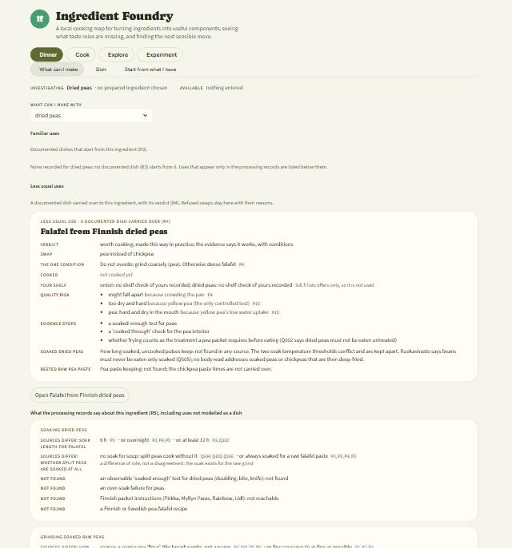

Pick an ingredient (the 18 that a documented dish or transfer starts from).
Two labelled groups, in the order the records hold them:
- **Familiar uses:** R3 documented dishes whose route starts from the
  ingredient.
- **Less usual uses:** R4 transfers whose route uses it, refused ones
  included.

Each entry shows:
- its **verdict** in words: a documented dish and its tradition, or the
  transfer's verdict, whether it is made in practice, and what the evidence
  says;
- the swap ("pea instead of chickpea");
- **the one condition**: the stage R5's `misses` say breaks the route, the
  skipped one first ("Do not skip: blanch (rutabaga). Otherwise raw thin
  slices stay crunchy... G20, G21");
- **cooked**: from the user's control records, otherwise "not cooked yet";
- **your shelf**: only the user's own shelf checks. lidl.fi is never used,
  so today every line says "no shelf check of yours recorded";
- **quality risks**: R5 failures at the step that makes the dish ready to
  eat, and each member's own failures there;
- **where the evidence stops**, and the keeping and safety notes of the
  intermediate states the route passes through. Pea falafel shows the FS1
  gap in words: "Ruokavirasto says beans must never be eaten only soaked
  (Q505); no body read addresses soaked peas or chickpeas that are then
  deep-fried", and "whether frying counts as the treatment a pea packet
  requires".

**Pea soup.** The recommendation expected pea soup as a familiar use of
dried peas. **R3 holds no pea-soup dish**, so the familiar group says "None
recorded for dried peas: no documented dish (R3) starts from it" rather than
inventing one. Pea soup appears where the records do hold it: in the R5
soaking record's conflict, "no soak for soup: split peas cook without it
(Q104-Q106)", shown under the ingredient's processing records. Recording
*hernekeitto* as an R3 construction is a data-round task.

### 2. A dish as a component-branch overview

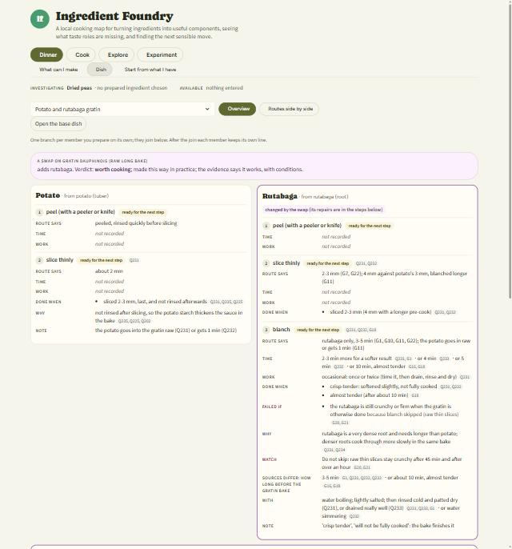
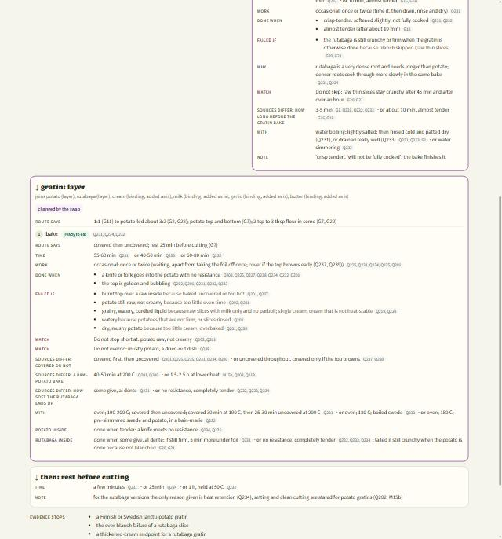

- One branch per independently prepared member, side by side. The joins
  follow in order, a nested join before the one that holds it.
- Each step shows:
  - a badge, **ready for the next step** or **ready to eat**, with its
    sources, or "endpoint not recorded";
  - what the route says;
  - the times, as separate versions with their sources;
  - the kind of work, in words ("occasional: once or twice");
  - done when and failed if;
  - **Why**: the one `depends` entry that explains the step;
  - **Watch**: what fails if it is skipped or overdone;
  - "Sources differ" for each conflict, kept as versions.
- After a join, every heat step gives **each member its own line**: potato
  "done when a knife meets no resistance"; rutabaga "some give, al dente ·
  or no resistance, completely tender; failed if still crunchy". A member
  with no recorded endpoint says **"not found"**, with the sequence's note
  where it has one ("onion inside: not found. No source states the onion's
  own endpoint inside the ball").
- The overview ends with:
  - the finishing stages (rest before cutting);
  - "Other documented ways": the R5 alternatives as cited notes, each its
    own route, never mixed in;
  - where the evidence stops;
  - the keeping times of the states the route passes through, with their
    authority;
  - the sentence "Done-when checks are cooks' signs that a step has worked.
    They are not food-safety limits."
- A route with no R5 sequence (most R3 dishes) still opens. Its endpoints
  say "endpoint not recorded".

### 3. Routes side by side

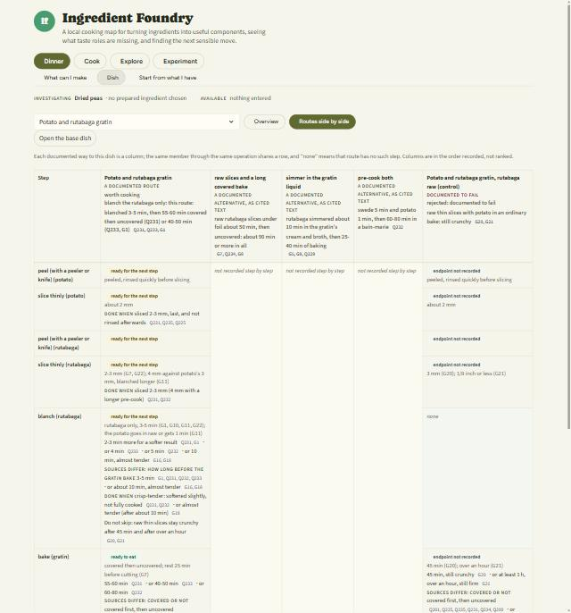

- **Columns:**
  - the route itself;
  - the dish's other R3 routes;
  - each R5 `alternative`:
    - a whole route, if it names one;
    - otherwise its cited text, marked "not recorded step by step".
- **Rows** are corresponding steps: the same member through the same
  operation. A route without the step shows **"none"**. For the gratin, the
  rejected raw-rutabaga route is its own column, headed "documented to
  fail", with "none" in the blanch row.
- The "blanch the rutabaga only" alternative, which says "this route: ...",
  is attached to the route's own column instead of duplicating it.
- Conflicts within a step are choices ("3-5 min · or about 10 min, almost
  tender"), never one number.
- Columns are in the order recorded. No column is ever built from steps of
  different routes. A note under the table says that taking a step from one
  column and a step from another is a combination nobody documented.

### 4. A swap is a changed branch

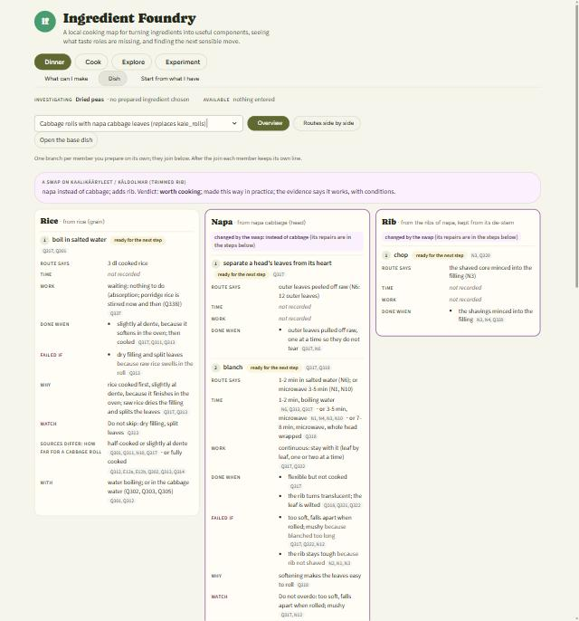
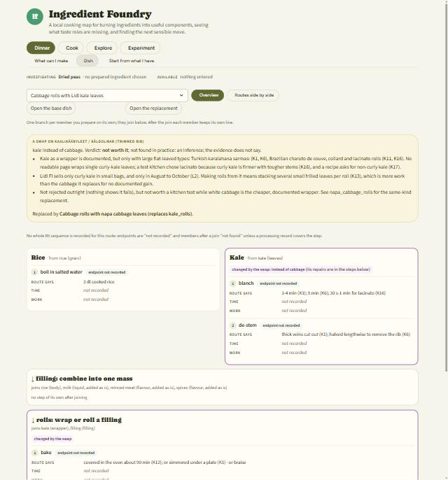

- A transfer opens as its base dish's overview. A banner says:
  - what changed ("napa instead of cabbage; adds rib");
  - the verdict, whether it is made in practice, and what the evidence says.
- The branches the swap changes are outlined and marked "changed by the
  swap: instead of cabbage". Their repairs are their own steps ("thick rib
  shaved off (N3)", the covered bake). "Open the base dish" goes to the
  original.
- **A refused swap stays visible.** Curly kale rolls show "not worth it", all
  three reasons, and "Replaced by Cabbage rolls with napa cabbage leaves",
  with a button to open it. The raw-rutabaga gratin shows "rejected:
  documented to fail".

### 5. Start from what I have

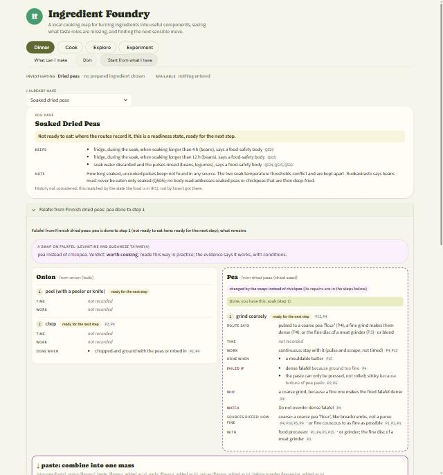
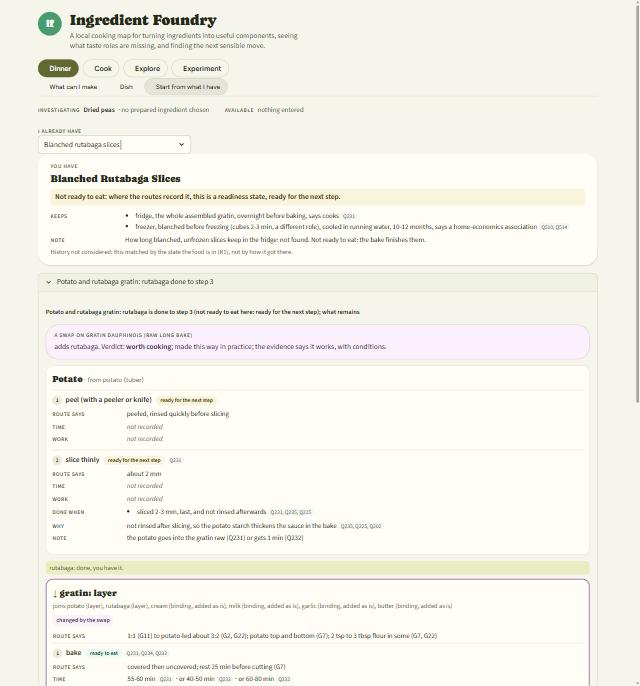

- Pick one of the 17 recorded intermediate states. `conditions.from_state`
  finds every documented route through it. Each opens as the overview:
  - the held branch says "Done, you have this: soak (step 1)" and shows
    only its remaining steps;
  - a branch held to its end collapses to one line;
  - the other members' branches and the joins remain.
- The card at the top shows:
  - how long the state keeps, each line with its authority in words ("says
    a food-safety body Q526", "says a home-economics association Q510,
    Q514", "says cooks");
  - the intermediate's note ("How long soaked, uncooked pulses keep: not
    found in any source...");
  - **Not ready to eat** for a readiness state;
  - **History not considered**, where the match was by R1 `key()` (a part
    plus operations), not by the exact step that made it.
- A state recorded at a step (a rested pea paste, a baked gratin) is matched
  exactly, and the history note is left off.

### 6. The mindmap, demoted

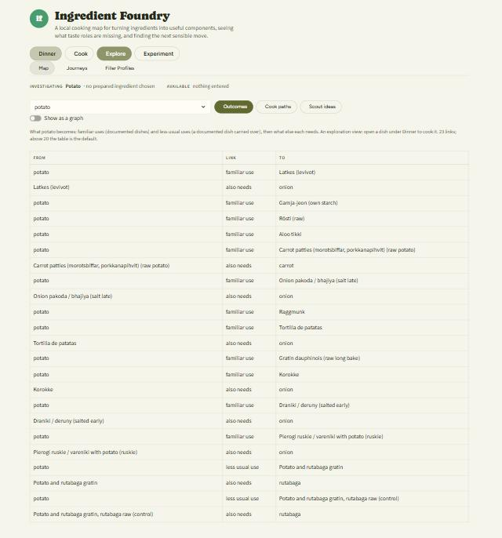
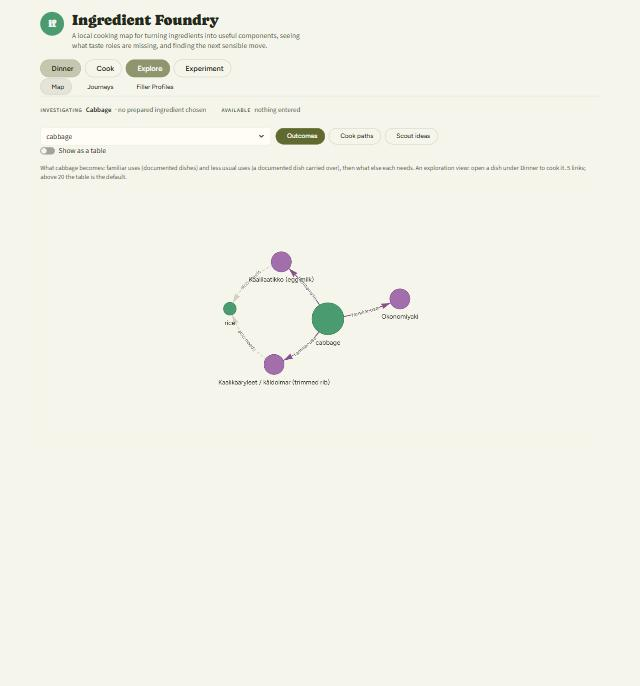

- Explore › Map has a new first view, **Outcomes**:
  - the ingredient;
  - its outcomes as the second ring: documented dishes as "familiar use",
    transfers as "less usual use";
  - the other raw ingredients each outcome needs.
- Above 20 links the **table is the default** (R4.1), with a toggle to the
  graph. Potato has 23 links, so it opens as a table; cabbage has 5, so it
  opens as a graph.
- The hint calls it an exploration view and sends the cook to Dinner to
  cook.
- "Cook paths" and "Scout ideas" are unchanged.

### 7. Record what was cooked

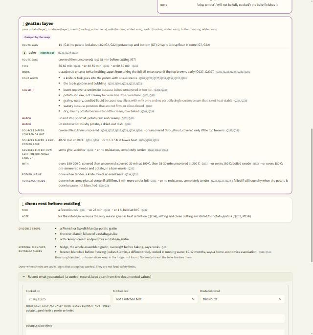

Under every dish, the expander "Record what you cooked (a control record,
kept apart from the documented values)" holds:
- the date;
- the kitchen test, KT1-KT12, read from the open-question register;
- the route followed: this route, or one of its documented R5 alternatives,
  so KT8's raw long covered bake is recorded as itself;
- what each step actually took;
- where each member ended up;
- a verdict: worked as documented, worked with changes, failed or
  inconclusive. Words, not a scale;
- notes.

**Where the records are stored.** `records/control_records.yaml` and
`records/shelf_checks.yaml` at the repository root. Each file is created on
its first save, with a comment header. The paths can be overridden with
`FOODPREP_CONTROL_RECORDS_PATH` and `FOODPREP_SHELF_CHECKS_PATH`.

- **Separate from the documented data.** The records are never under
  `src/foodprep/data/` and never in SQLite.
- **The existing store is reused, not duplicated.** The tastings' strict
  append-only writer (parse check, round-trip, duplicate refusal) was
  generalised into `tasting.append_record_yaml`, and both stores use it.
  `tastings.yaml` itself is not reused: every trial there must test a Scout
  hypothesis (`analogy_id` is required), and a kitchen test of a documented
  route is not one.
- **Shown beside, never merged.** Each step shows the user's recorded time
  as a separate "Your record" line. The documented times are unchanged (a
  test checks this). A "Your kitchen records" card sits under the overview.
  "What can I make" lists the cooking under "Cooked".
- **A record is checked before it is written.** It is refused if:
  - the route is unknown;
  - a step address is not in the route;
  - the alternative is not documented;
  - the verdict is not one of the four;
  - the date or the KT id is malformed;
  - it says nothing beyond the verdict.

A small **shelf-check** form sits under "What can I make". It is the only
source of availability.

### 8. The Taste Circle label

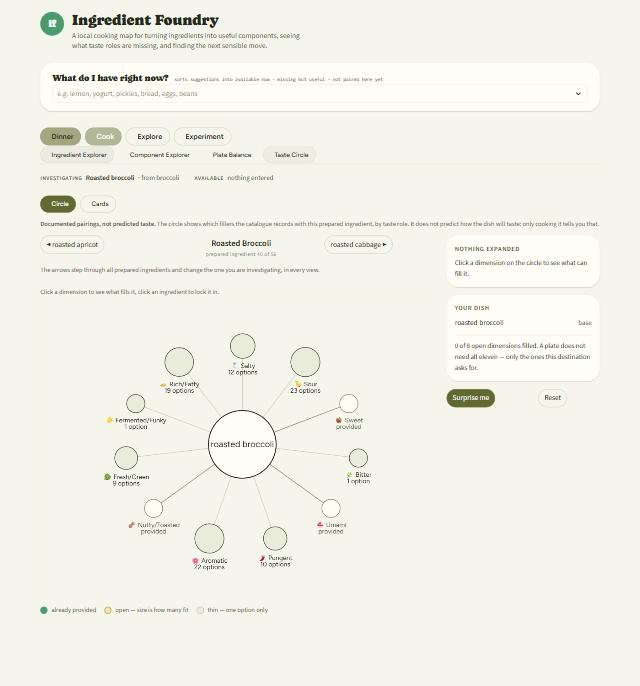

Above both Taste Circle views: "Documented pairings, not predicted taste.
The circle shows which fillers the catalogue records with this prepared
ingredient, by taste role. It does not predict how the dish will taste: only
cooking it tells you that." (Y712, IE7.)

## Left out, and why

- **No new data schema.** The R6 data extensions belong to a later data
  round, chosen after the cook has used R7:
  - `compensated_by` and step correspondence;
  - violation and repair;
  - storage class;
  - value levels;
  - sourced history.

  Row alignment therefore uses identity: the same member through the same
  operation. A long covered bake is not shown as doing the blanch's job,
  because no record says so.
- **Pea soup is not a dish here** (see item 1). Adding it is data work.
- **No composed route, "best route", or preference order.** Columns and
  lists keep the order recorded.
- **No similarity-based substitutes.** Only R4's documented transfers
  appear, and the refused ones stay visible.
- **No force graph of a dish's routes.** Routes are aligned columns. The
  only graph is the Map's outcome ring, below 21 links.
- **No process notation** (BPMN, flow graphs, FOON trees), no computed
  schedule, no multi-dish planner. The kinds of work are shown in words.
- **No safety claim** from structure or tradition. Done-when checks are
  labelled as not being safety limits. Keeping times show their authority,
  and "not known" where there is none.
- **No scores, ranks or predicted taste.**
- **The app still opens on Cook › Ingredient Explorer.** Dinner is first in
  the rail but not the landing page. Several existing tests and the R4.1-R4.2
  usability work assume the current landing page; changing it is a one-line
  decision (`tab_rail`'s default section) for the user to make after IE1.
- **Kitchen-test results do not flow back into `transfers.yaml`** or the
  tastings, as the R3-R6 roadmap once suggested. R6's recommendation
  overrides that: a control record is shown beside the documented route and
  never merged into it.

## Running it

```
PYTHONPATH=src py -3.11 -m streamlit run app.py
```

Then **Dinner**. Tests: `tests/test_dinner.py` (the view model and renderers,
every route in both views), `tests/test_kitchen_records.py` (the store),
`tests/test_dinner_app.py` (the running app). See also `ie-checks.md` and
`limitations.md`.
