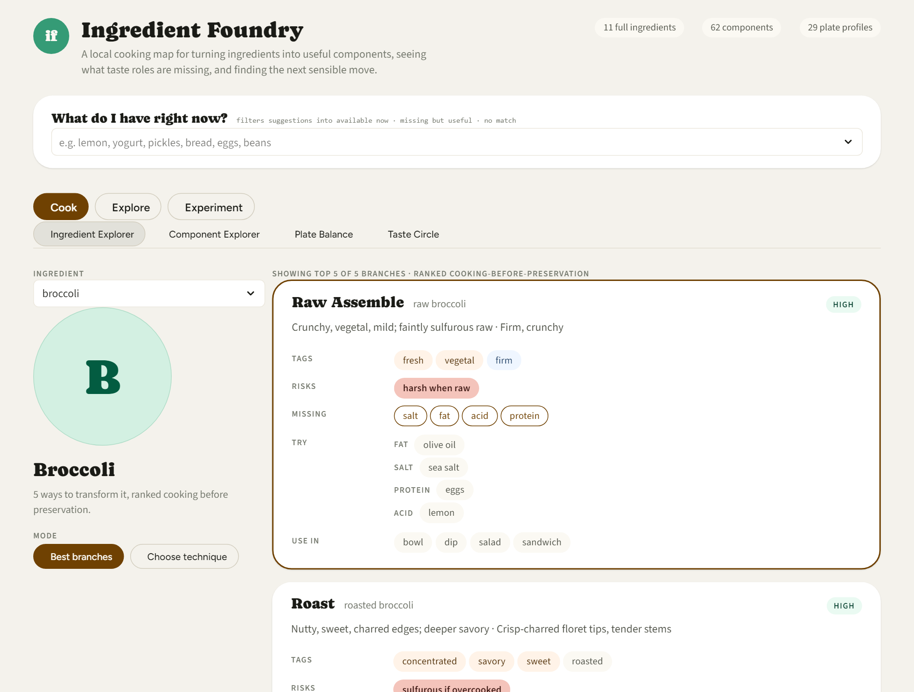
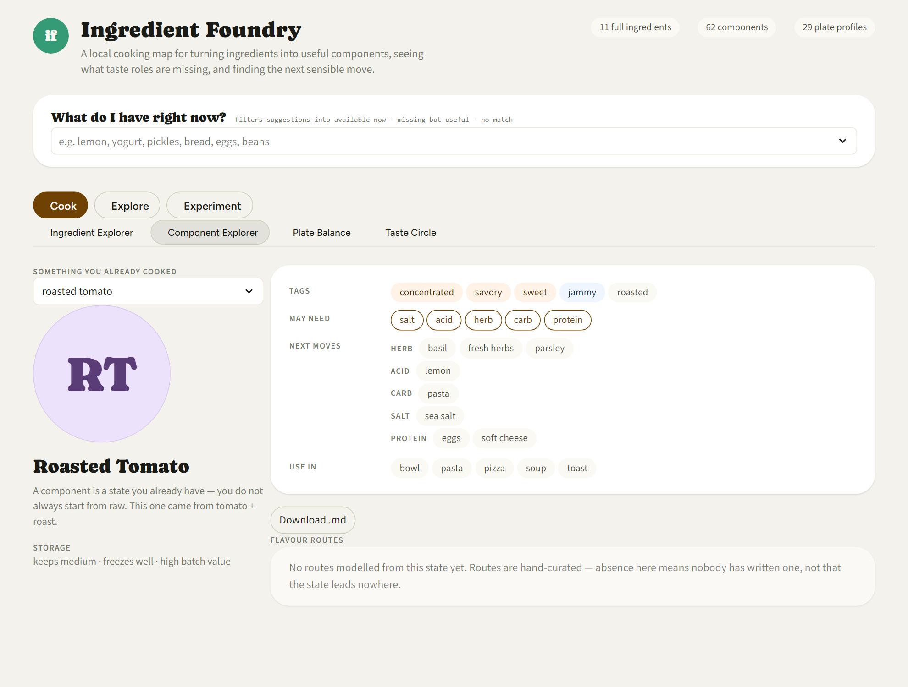
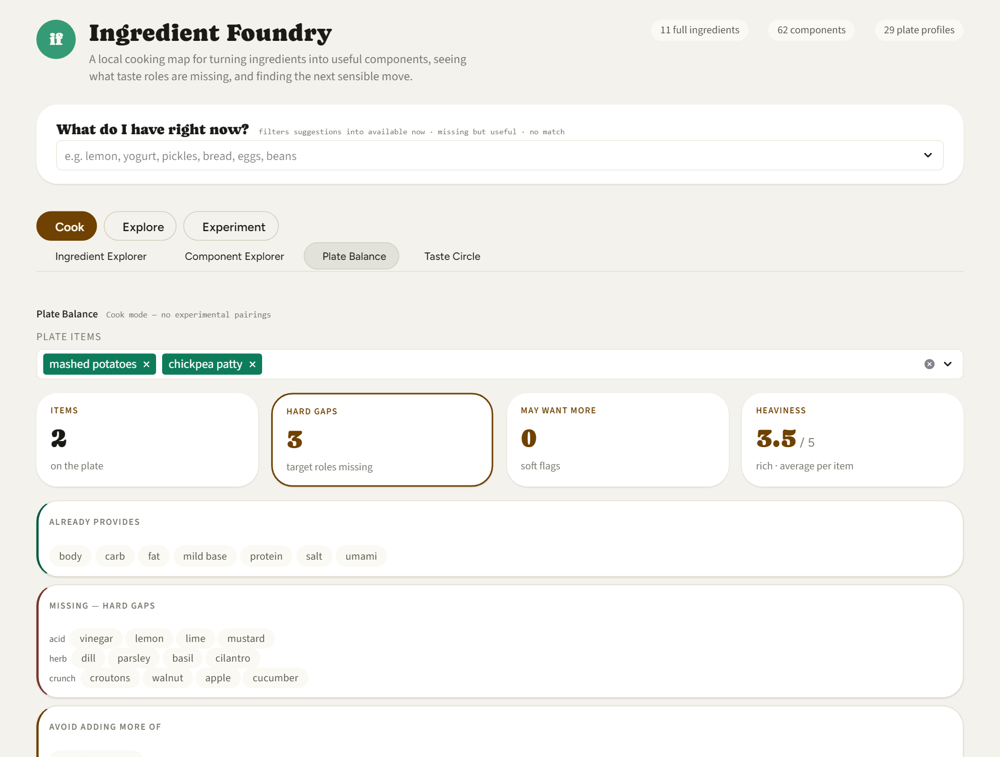
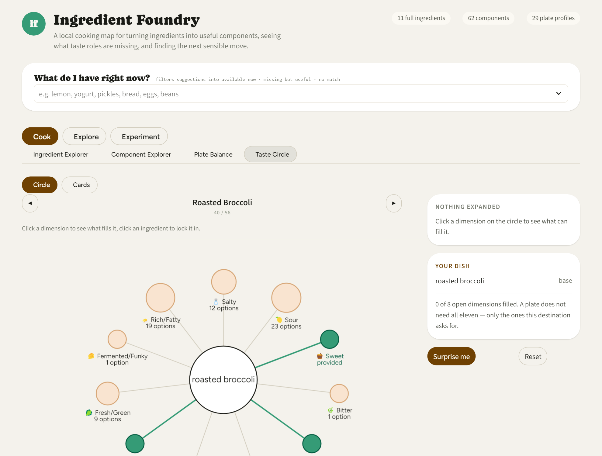
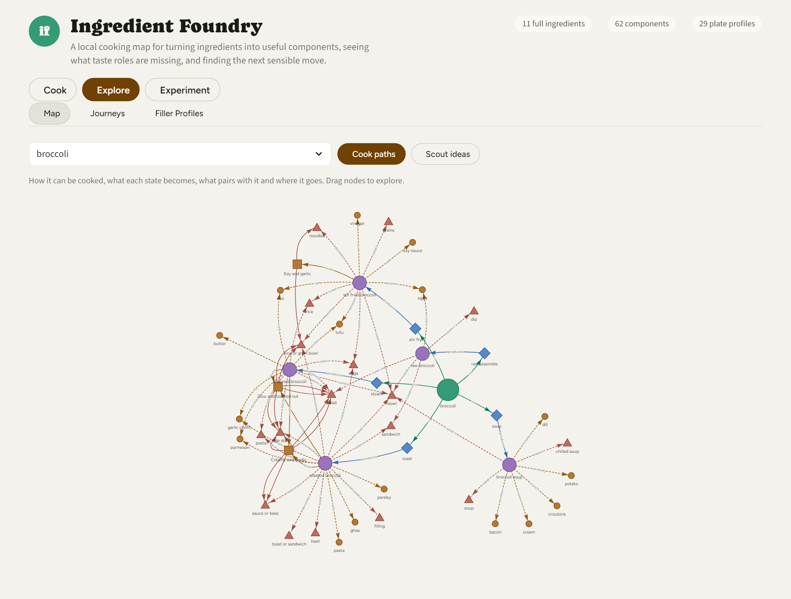
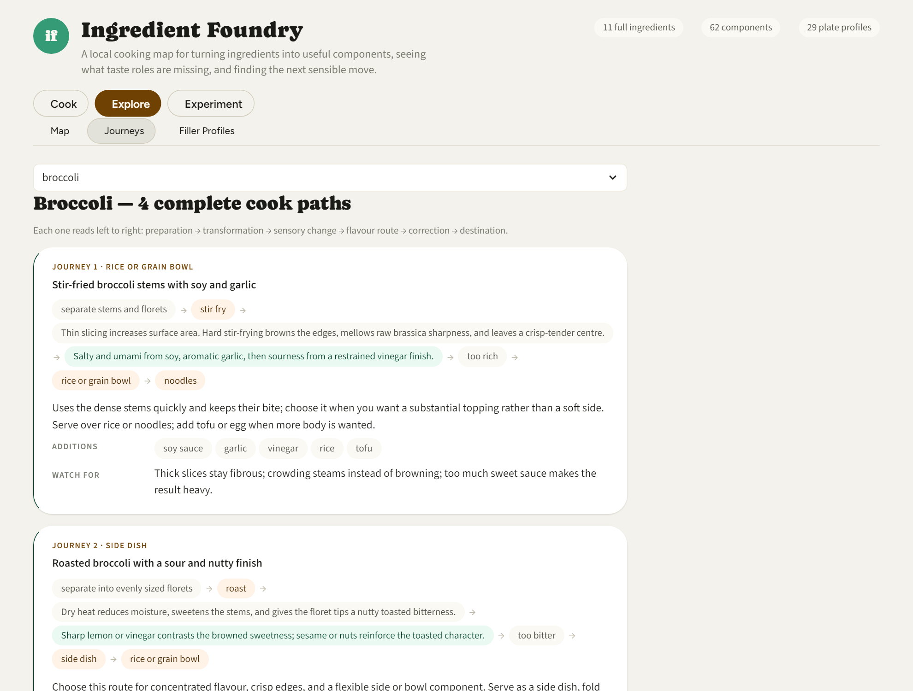
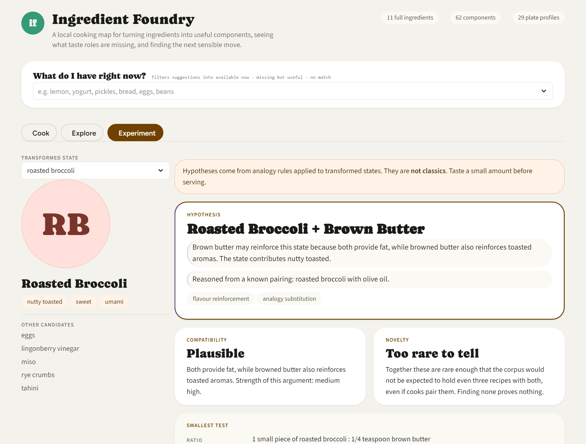

# Screen audit

Seven screens, plus the shared chrome every screen carries. Screenshots are
fresh captures at 1400×900. Finding ids (**D1…**) are shared with
[`workflow-audit.md`](workflow-audit.md); the cross-screen findings live there.

Each finding: **Observation → Evidence → User impact → Dembrandt principle →
Possible remedy → Confidence.**

---

## Shared chrome (every screen)

**D7 · Internal counts in the header**
- **Observation:** the topbar shows "11 full ingredients · 62 components · 29
  plate profiles" on every screen.
- **Evidence:** every screenshot below; the [probe](screenshots/evidence/dembrandt-probe-output.txt)
  finds "component" and "plate profile" on all 8 screens, and in each case the
  only occurrence is this header.
- **User impact:** the first words on every screen are catalogue jargon a cook
  cannot act on. "Plate profile" appears nowhere else.
- **Principle:** nielsen #2 *Match between system and real world* ("avoid
  exposing internal system concepts"); #8 *Aesthetic and minimalist design*
  ("does every element earn its place?"); information-architecture
  *Internal vocabulary is not customer vocabulary*.
- **Remedy:** drop the counts, or move them to a footer or about page.
- **Confidence:** Verified (presence); Supported (impact).

**D8 · Same concept, two names**
- **Observation:** the availability box's hint reads "…available now · missing
  but useful · **no match**"; the cards it controls say "**Not paired here
  yet**".
- **Evidence:** [`mobile-375-rails-wrap-and-stale-hint.jpg`](screenshots/evidence/mobile-375-rails-wrap-and-stale-hint.jpg);
  `streamlit_app.py:116`. The cards were renamed in the 2026-11-21
  usability pass and the hint was missed.
- **User impact:** the hint promises a "no match" group that never appears;
  and "no match" is the very reading the rename removed.
- **Principle:** nielsen #4 *Consistency and standards*; information-architecture
  *Naming is design* ("If it is called 'Project' in the sidebar, it must be
  called 'Project' in the breadcrumb…").
- **Remedy:** make the hint use the card labels.
- **Confidence:** Verified.

**D3 · Keyboard focus is invisible on the rails** — see workflow-audit D.

---

## Cook › Ingredient Explorer

- **Works well (nielsen #8, IA "Hide, don't delete"):** top 5 branches only;
  *Choose technique* hides the rest one click away.
- **D5 (nesting):** a third pill level, *Best branches / Choose technique*,
  sits under section and tab. See workflow-audit A.
- **"Branch"** is a coined term used only here (probe), counted in D6.

## Cook › Component Explorer

- **D6 (naming):** the tab is "Component Explorer"; the panel heading says
  "Something you already cooked"; the body says "A component is a state you
  already have". That is three terms for one entity on one screen.
  *IA: one name per destination; nielsen #4.* **Verified.**
- Route cards mark on-hand elements by colour only: previously known (C4 in
  R1). *operational-expert: "Status label beside colour for accessibility".*

## Cook › Plate Balance

- **Works well:** the empty state ("Pick one or more plate items to see what
  the plate has, what it lacks, and what to add") is exactly nielsen #10's
  "empty states are an opportunity for contextual help". **Verified** (probe).
- **"Hard gaps", "target roles missing", "Cook mode — no experimental
  pairings"** are coined here only (probe); counted in D6.
- `unsuitable_provided` is computed and not shown: previously known (R1).

## Cook › Taste Circle

- **Works well:** colour encodes **state** (provided / open / thin) with an
  on-screen legend, as coordinated-data-views prescribes ("colour encodes
  state, the label encodes identity… the legend then explains states"). It's
  the one view that already follows that rule. **Verified** (`graph.py:315`,
  `.tcm-legend`).
- **D5:** a third pill level (*Circle / Cards*).
- **Silent reset:** changing the state clears the built dish with no warning.
  Previously noted in R1's matrix. *nielsen #3 User control, #5 Error
  prevention.*

## Explore › Map

- **D12 (colour semantics):** green = *ingredient* here, but *have it /
  provided* everywhere else; amber = *filler, route* here, but *primary /
  selected* in rails and buttons; purple = both *component* and *hypothesis*.
  See workflow-audit C.
- **D13 / D14:** no coordinated selection, no legend. Previously known (R1 B2–B4).
- Labels ≈6.6 px at the default fit. Previously known (R1 B1).
- **D11:** *Scout ideas* repeats the Scout tab's hypotheses. See workflow-audit A.

## Explore › Journeys

- **Works well:** each journey card reads as a causal chain in plain language,
  the strongest nielsen #2 and #10 surface in the app.
- **D16 (empty state):** butter gives "No complete journeys modelled for
  butter yet." Honest, but with no next step (no pointer to Ingredient
  Explorer, which does have butter's branches). *nielsen #10.* **Verified**
  (probe).

## Experiment › Scout

- **Works well:** the disclaimer, the separate Compatibility and Novelty cards
  and the smallest test serve nielsen #1 and #9 for uncertain knowledge.
- **D9 (error wording):** saving a tasting without the safety tick shows
  "**Safety_confirmed is required before recording a trial.**" That's a raw
  field name. *nielsen #2 and #9* ("Never show raw error codes… state clearly
  what went wrong in plain language"). **Verified** (probe).
- **D10 (irreversible save):** see workflow-audit E.
- **D16:** ghee gives "No generated hypotheses for ghee." with no reason;
  rules are scoped away from cooking fats, and the screen doesn't say so.
  *nielsen #9 and #10.* **Verified.**
- Rejected hypotheses never shown: previously known (R1 C3).
