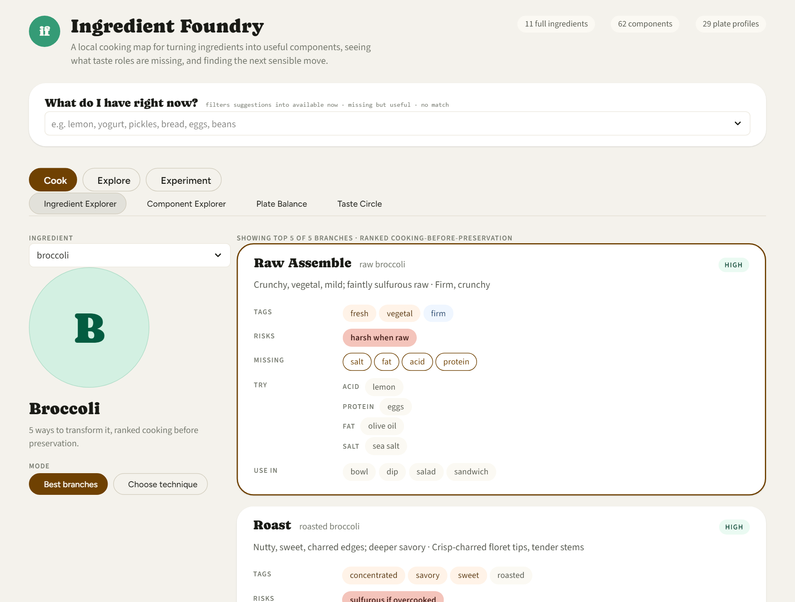
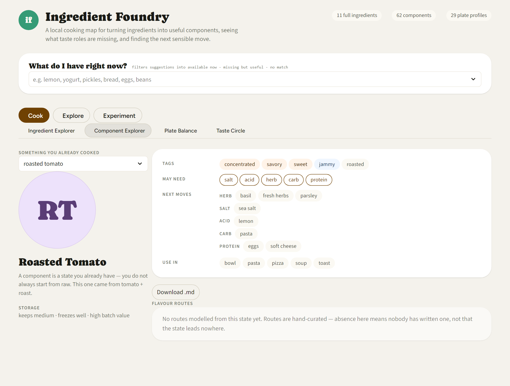
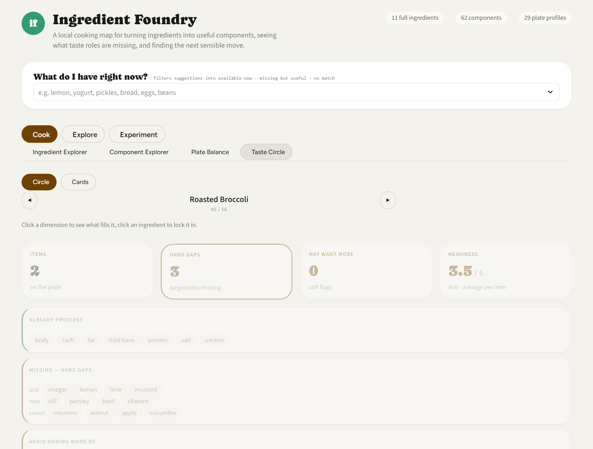
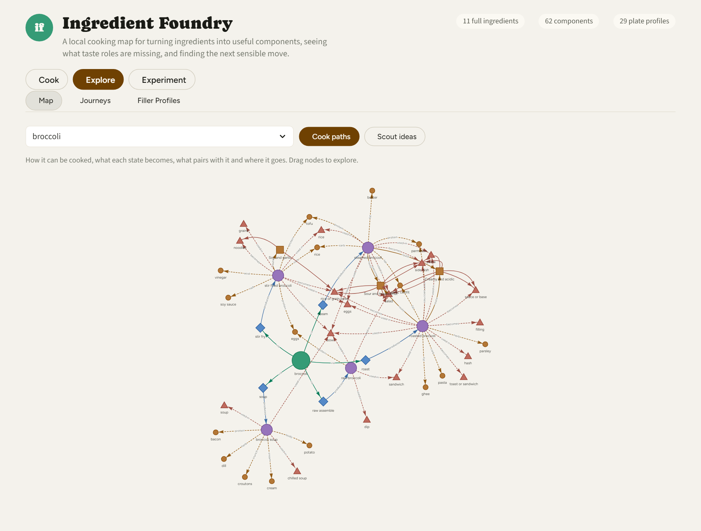
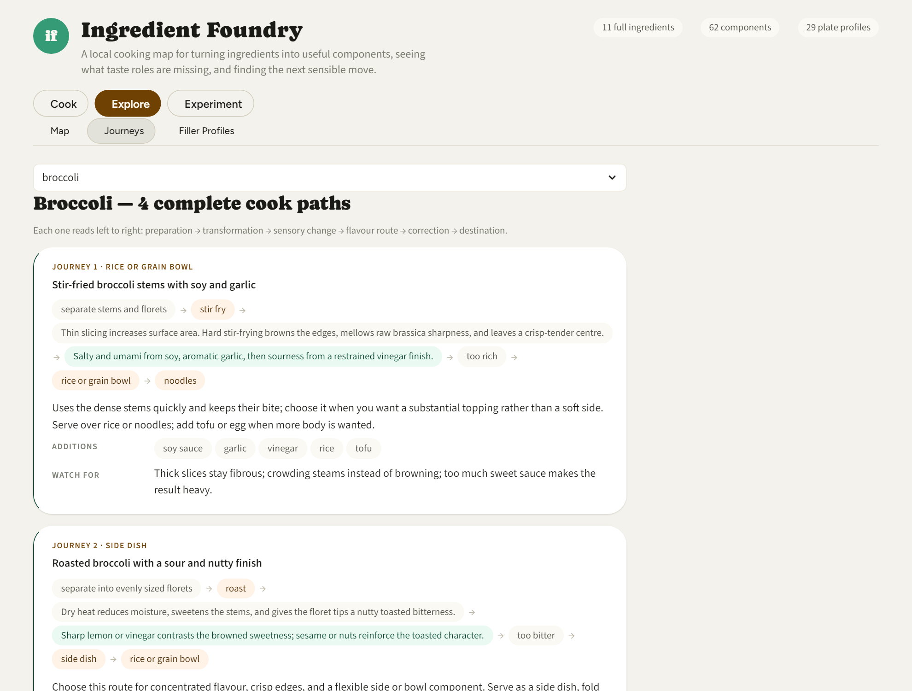
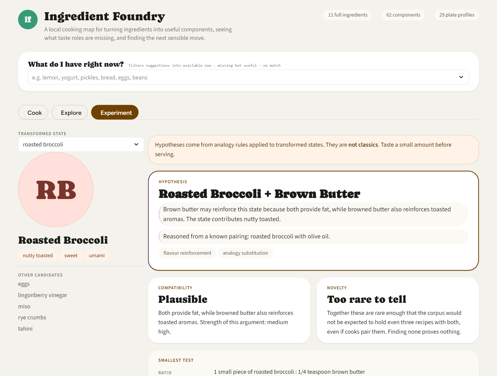

# Current interface — Ingredient Foundry (as of `7bd7b01`, 2026-11-22)

Read from the code (`src/foodprep/ui/`) and the running app (Streamlit 1.50,
1400×900). Screenshots in `screenshots/` were captured fresh for this research
with the project's own `scripts/capture_screenshots.py` (output redirected; the
committed README screenshots were not touched).

## Navigation model

Two levels of styled radio "pills": a **section**, then a **tab** inside it.

| Section | Tabs | Subject picker |
| --- | --- | --- |
| Cook | Ingredient Explorer · Component Explorer · Plate Balance · Taste Circle (*Circle* / *Cards* views) | ingredient · state · plate items · state |
| Explore | Map (*Cook paths* / *Scout ideas*) · Journeys · Filler Profiles | ingredient · ingredient · filler |
| Experiment | Scout (only tab, so no tab rail) | state |

Above the rails: a topbar (counts) and **"What do I have right now?"**, a
multiselect of ingredients on hand. It is shown only on Ingredient Explorer,
Component Explorer, Plate Balance, Taste Circle and Scout.

## Interaction state — what is shared, what is not

This is the property the Qlik comparison turns on.

- **One global selection:** the available-ingredients list
  (`available_items`). It persists across tabs and sections, including through
  Explore, where it is hidden.
- **Six independent subject pickers:** `explorer_ing`, `map_ing`,
  `journey_ing` (ingredients); `component_explorer_comp`,
  `tab_scout_component_select`, `tcm_component` (transformed states). Each
  remembers its own value (`_STICKY_WIDGETS`), but choosing tomato in one does
  not change any other. Every picker defaults to broccoli or roasted broccoli
  (Component Explorer defaults to roasted tomato).
- **One cross-link:** Filler Profiles → "See *X*'s branches" jumps to
  Ingredient Explorer with *X* selected. No other view links to another.
- **No history:** no back/undo; Streamlit's browser Back does not step
  through app state.
- **Section switch resets the tab:** leaving Cook from Taste Circle and
  coming back lands on Ingredient Explorer, the section's first tab.

## The views

### Ingredient Explorer
Up to five branch cards per ingredient (technique → state): tags, risks,
missing roles, suggested fillers ("Try"). With items on hand, "Try" becomes
**Available now / Missing but useful / Not paired here yet**, plus **Routes
with what you have**. Cooking-medium fillers are dimmed, without a legend.

### Component Explorer
Starts from a cooked state: tags, risks, "may need", next moves, uses, storage,
and flavour-route cards. Route cards mark on-hand elements by **colour only**.

### Plate Balance
KPI row (items, hard gaps, may want more, heaviness /5), provided roles, gaps
with fillers, risks, an avoid list. The query also computes
`unsuitable_provided` (roles the destination finds unsuitable); **the UI never
shows it**.

### Taste Circle
Circle view: a fixed-layout vis-network graph, the state in the centre and
eleven flavour dimensions around it. Clicking a dimension fans out its fillers
and the rail lists which are in your kitchen; clicking a filler locks it. Cards
view: the same dish as a grid of pickers. Both views share one dish.

### Map (Explore)
Force-directed vis-network graph of one ingredient: technique → state →
fillers, routes, destinations. Built with pyvis and drawn by the same custom
component as the Taste Circle. Measured for broccoli at the default fit:
**47 nodes, 80 edges, node labels ≈ 6.6 px, edge labels ≈ 5.6 px** (tomato:
80 nodes, 120 edges). No legend, no filtering, no focus mode, no details
panel. Clicking a node only bolds its edges (vis default); clicks are not
reported to the app. Tooltips show raw ids. *Scout ideas* swaps in a
hypothesis graph (19 nodes for broccoli).

### Journeys (Explore)
Text cards for complete cook paths: preparation → transformation → sensory
change → flavour route → correction → destination. Not linked to the Map,
although both describe the same nodes.

### Filler Profiles (Explore)
Roles, repairs, "Avoid when", availability, mode, pairings table. The only view
that shows **why a filler is unsuitable**.

### Scout (Experiment)
One hypothesis at a time: hypothesis card, separate Compatibility and Novelty
cards, smallest test, *Record a tasting* form, trial history. Other candidates
are jump buttons. **Rejected hypotheses are never shown:** the tab calls
`generate_scout_hypotheses(CONN, comp)` without `include_rejected=True`, so the
"Show N rejected hypotheses" expander and the "N rejected, with reasons" note
are dead code. Roasted broccoli has 45 rejected hypotheses, each with a
readable reason.

## User journeys the interface supports

| Intent | Path today |
| --- | --- |
| "What can I make from X?" | Cook › Ingredient Explorer (pick X, optionally fill "What do I have") |
| "I already cooked X" | Cook › Component Explorer |
| "My plate needs something" | Cook › Plate Balance |
| "Build a dish around X" | Cook › Taste Circle |
| "Show me everything X connects to" | Explore › Map (re-pick X) |
| "Walk me through cooking X" | Explore › Journeys (re-pick X) |
| "What is this filler for?" | Explore › Filler Profiles |
| "Something new to try with X" | Experiment › Scout (re-pick the state) |

Each row is self-contained. Moving between rows means re-picking the subject.

## Documentation vs implementation

| Document says | Implementation | Note |
| --- | --- | --- |
| `design-handoff-reply.md`: "pyvis stays", for Map, Scout Map and Taste Circle Map | pyvis only builds the Map's data; every graph is drawn by a custom vis-network component; Scout Map is now a view of Map | Superseded by later commits; not wrong when written |
| `design-handoff-reply.md`: broccoli map 40 nodes, tomato Scout Map 115 | 47 and 44 | Scout scoping (2026-11-21) cut the hypothesis graph |
| `PRODUCT_DESIGN.md`: the tabs are the **Workshop** interface for curation; a guided consumer interface comes later | The README presents the same tabs as the product (Cook / Explore / Experiment) | The Workshop vs guided split never happened; this research is effectively about the guided interface |
| `ROADMAP.md` phase 9, "Build the guided interface" | Not started as a separate surface | Same point |
| Scout code: "Show N rejected hypotheses" | Never rendered (rejected list is always empty) | Dead code, not a documentation claim; found in this research |
| README: Plate Balance shows "what not to add more of" | True; `unsuitable_provided` computed but unused | Partial |
